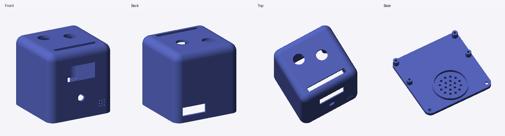

# Galaxy Cube

A small 3D-printed box that lets Xbox, Nintendo Switch and PlayStation players join **GalaxySMP** and use
GalaxySMP voice chat. Raspberry Pi Zero 2 W, a 128×64 screen, a knob and two buttons (TALK, MUTE).



- **Full build guide:** [GALAXY_CUBE.md](GALAXY_CUBE.md) (parts, wiring, software, website, case, manual)
- Link a Cube: **galaxymc.us/cube**

## What's done

| Part | Status |
|---|---|
| Screen, knob, menus, settings | ✅ |
| Wi-Fi setup from a phone | ✅ |
| Linking to galaxymc.us with a code | ✅ |
| Consoles join through the Cube (Server Broadcast) | ✅ |
| Voice chat: TALK, MUTE, groups, nearby volume, headset or speaker | ✅ |
| 3D-printed case (`case/`) | ✅ |
| Install, auto-start, update, hardware check | ✅ |
| Phone simulator (`simulator/`) | ✅ |
| Galaxy Cube Lite (ESP32, no voice) | later |

Everything is tested on a computer in "fake mode" with a pretend website (16 checks, `dev/drive.py`).
It hasn't run on a real Pi yet: that's the next step.

## Build one

No soldering needed, with a built-in mic and speaker. Parts list: GALAXY_CUBE.md §2.

1. **Print** `case/shell.stl`, `case/base.stl` and 2 × `case/button_cap.stl` in dark PLA, and
   `case/light_strip.stl` in clear PLA.
2. **Wire** the parts with jumper wires as in GALAXY_CUBE.md §3.
3. **SD card:** flash **Raspberry Pi OS Lite (64-bit)** with Raspberry Pi Imager. In its settings, turn on SSH
   and type your Wi-Fi (only needed for this first install).
4. **Install:** connect to the Pi (`ssh pi@raspberrypi.local`) and run these three, one at a time:

```bash
git clone https://github.com/2819-dev/Galaxy-Cube.git galaxy-cube
```

```bash
cd galaxy-cube && sudo bash setup/install.sh
```

```bash
sudo reboot
```

5. **Check:** the screen shows the Galaxy Cube logo. If something's missing, run `sudo bash setup/check.sh`.
   It says in plain words what's OK and what to fix.

Updates later: `sudo bash setup/update.sh`

## Try it on your phone

`simulator/` is a phone app that acts like the Cube: the screen, a knob you turn with your finger, TALK and
MUTE, plus pretend versions of the setup page, galaxymc.us/cube, a console and voice chat. Host the folder
anywhere (for example GitHub Pages) and use **Share → Add to Home Screen**. It doesn't talk to the real website.

## Try it on a computer

```bash
pip install aiohttp pillow qrcode numpy aiortc
```

```bash
python3 dev/mock_site.py
```

In a second window, either play with it yourself:

```bash
CUBE_FAKE=1 CUBE_STUN= CUBE_API=http://localhost:8099 python3 -m cube.main
```

or run the full check:

```bash
python3 dev/drive.py
```

The screen is printed as text (and saved as `screen.png`). Type `u`/`d` + Enter to turn the knob, just Enter
to press it, `h` to hold/let go of TALK, `m` for MUTE, `q` to quit. Open http://localhost:8099/dev/link to
"link" the Cube.
